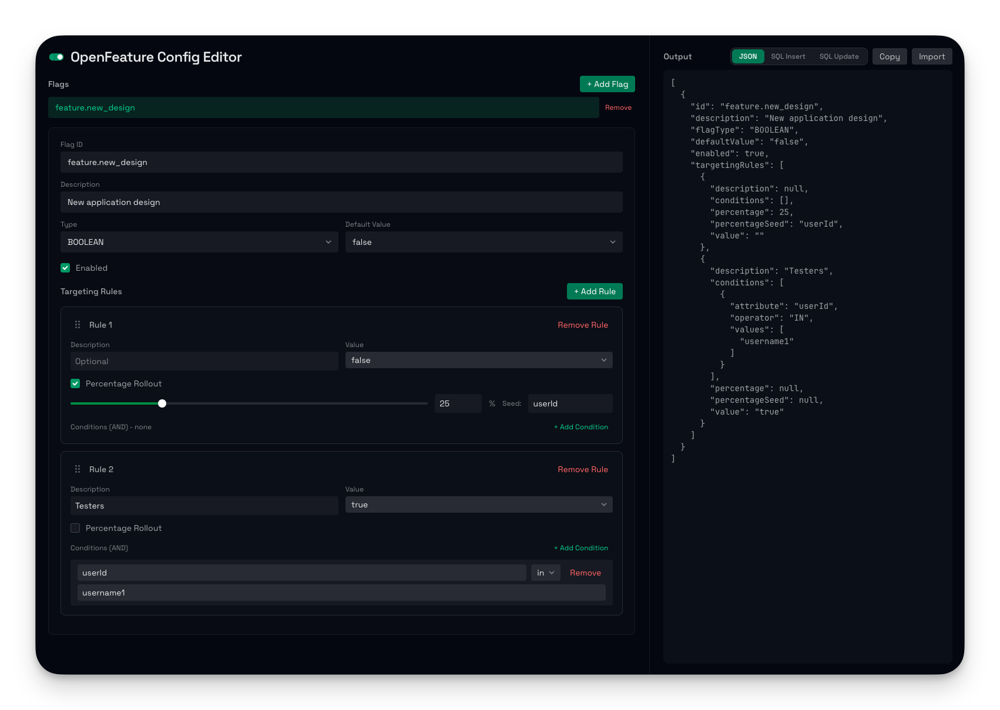

# OpenFeature Config Editor

A visual editor for creating and managing [OpenFeature](https://openfeature.dev/) feature flag configurations. Built with Astro, React, and Tailwind CSS.



## Features

- Create, edit, and remove feature flags (Boolean, String, Integer, Double)
- Define targeting rules with conditions and percentage-based rollouts
- Live JSON preview of your flag configuration
- Import existing configurations from JSON

## Run with Docker

```sh
docker run --rm -p 2233:8080 viascom/openfeature-editor
```

Then open [http://localhost:2233](http://localhost:2233) in your browser.

## Local Development

All commands are run from the root of the project:

| Command          | Action                                       |
| :--------------- | :------------------------------------------- |
| `pnpm install`   | Installs dependencies                        |
| `pnpm dev`       | Starts local dev server at `localhost:4321`   |
| `pnpm build`     | Build your production site to `./dist/`       |
| `pnpm preview`   | Preview your build locally, before deploying  |
